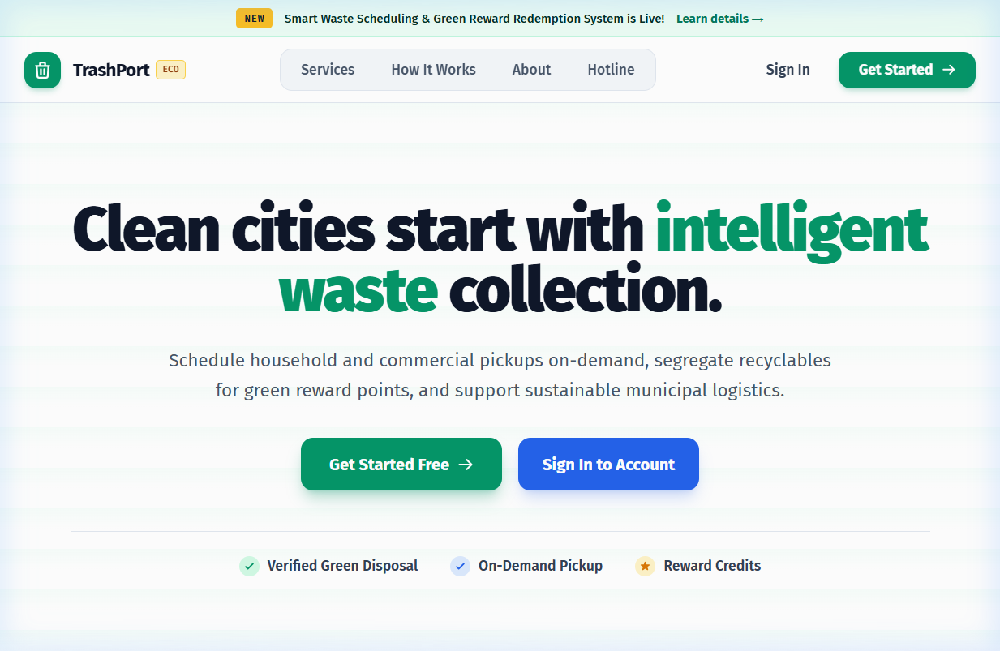
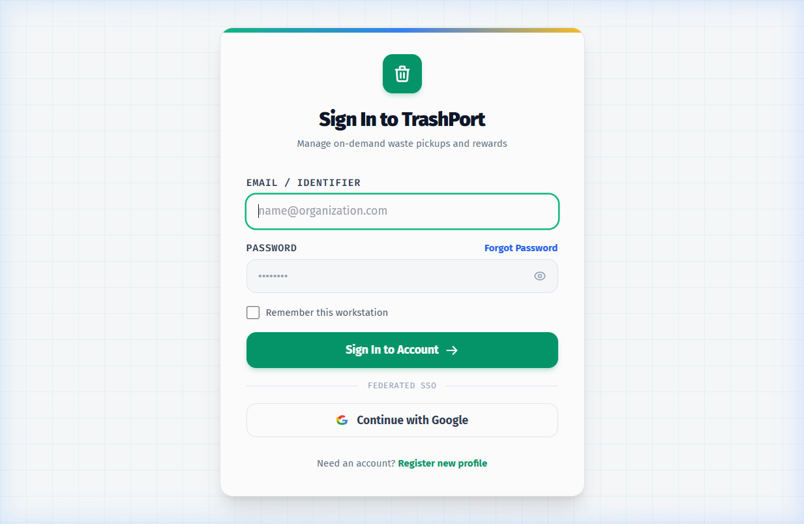
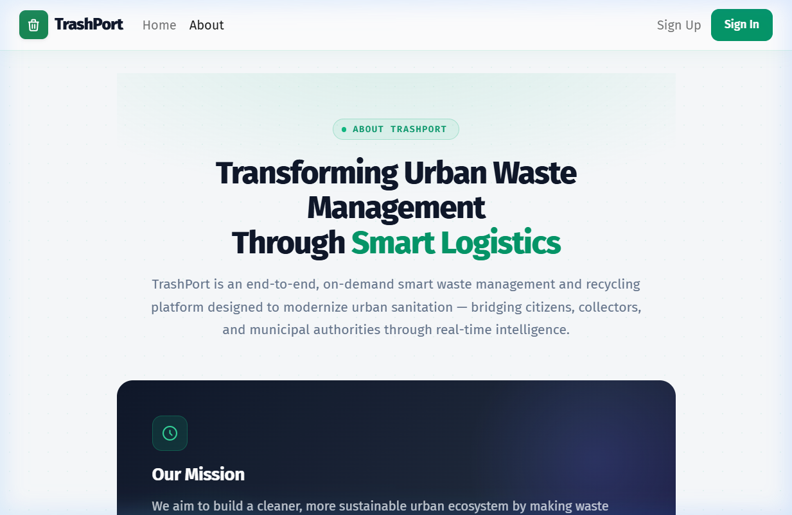
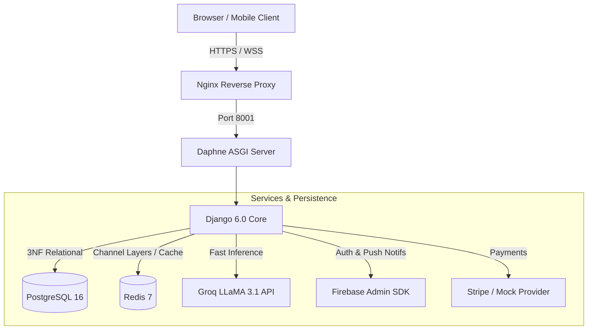

# ♻️ TrashPort — On-Demand Smart Waste Collection Platform

<div align="center">

[](https://trashport.shop/)
[](https://www.python.org/)
[](https://www.djangoproject.com/)
[](https://www.docker.com/)
[](https://firebase.google.com/)
[](https://github.com/features/actions)

**TrashPort** is a live, production-deployed, end-to-end smart waste management platform. It connects citizens, collectors, and municipal administrators through intelligent dispatching, real-time GPS tracking, dynamic pricing, and an AI-powered support assistant.

[**🌐 View Live Project →**](https://trashport.shop/)

</div>

---

## 📸 Screenshots

### 🏠 Landing Page


### 🔐 Authentication


### ℹ️ About


---

## 🚀 Key Features

### 👤 Citizen Portal
- **On-Demand Booking** — Schedule pickups for Dry Recyclables, Wet Waste, E-Waste & Hazardous materials
- **Interactive Mapping** — Pinpoint precise pickup location using Leaflet.js + OpenStreetMap with auto reverse-geocoding
- **Real-Time Tracking** — Live WebSocket tracking of assigned collectors with dynamic ETA
- **Green Rewards** — Earn wallet reward points redeemable across platform services
- **Online Checkout & Invoices** — Integrated payment simulation with itemized receipts and PDF invoice generation

### 🚛 Collector Dashboard
- **Proximity-Based Dispatch** — View and claim pickups ranked by distance and estimated payout
- **Simulated Aadhaar KYC** — Identity verification using Verhoeff checksum + SHA-256 masked hashing
- **On-Site Weight Verification** — Dynamic excess weight recalculation with automatic fee adjustments
- **Turn-by-Turn Routing** — Integrated road navigation via OSRM to citizen pickup destinations
- **Wallet & Payouts** — Real-time earnings (base rate + distance commission) with UPI withdrawal requests

### 🛡️ Municipal Admin Console
- **Operations Dashboard** — Live KPIs, active collector heatmap, and daily collection metrics
- **Hub Management** — Interactive map to add, move, suspend, and delete collection hubs
- **Zone Management** — Define geographic service zones, boundaries, and coverage radii
- **Category Pricing** — Configure fees per kg, reward points, and excess weight multipliers
- **Grievance Resolution** — Ticket management system for citizen complaints and feedback

### 🤖 Groq AI Assistant
- **Conversational Booking** — Natural language pickup scheduling, status checks, and FAQ resolution
- **Powered by Groq LLaMA 3.1-8B** — Sub-second inference for real-time chat responses

---

## 🏗️ Architecture



---

## 🛠️ Tech Stack

| Layer | Technology | Purpose |
| :--- | :--- | :--- |
| **Backend** | Python 3.13, Django 6.0 | Core application & business logic |
| **ASGI / Realtime** | Daphne, Django Channels 4 | WebSockets for live tracking & chatbot |
| **Database** | PostgreSQL 16 | 3NF relational data persistence |
| **Cache & Broker** | Redis 7 | Channel layers, dispatch state & session caching |
| **Package Manager** | Astral `uv` | Ultra-fast dependency resolution |
| **Frontend** | HTML5, Vanilla CSS, JS, Bootstrap 5 | Responsive UI |
| **Maps** | Leaflet.js, OpenStreetMap, OSRM | Geospatial mapping & road routing |
| **AI / NLP** | Groq Cloud (LLaMA 3.1-8B) | Conversational AI assistant |
| **Auth** | Firebase Authentication, Google OAuth 2.0 | Federated SSO & token auth |
| **DevOps** | Docker, Docker Compose, GitHub Actions | Containerization & automated CI/CD |
| **Hosting** | AWS EC2, Nginx | Production server |

---

## 📦 Quick Start — Docker (Recommended)

The easiest way to run the full stack (Django + PostgreSQL + Redis) locally:

### 1. Clone the Repository
```bash
git clone https://github.com/NobleSunil/TrashPort.git
cd TrashPort
```

### 2. Set Up Environment Variables
```bash
# Windows PowerShell
Copy-Item .env.example .env

# Linux / macOS
cp .env.example .env
```
Open `.env` and fill in your actual values (Firebase credentials, Groq API key, etc.)

### 3. Add Firebase Credentials
Place your Firebase service account key at the project root:
```
TrashPort/
└── serviceAccountKey.json   ← download from Firebase Console
```

### 4. Build & Start Containers
```bash
docker compose -f docker-compose.local.yml up --build
```
> App will be live at **http://localhost:8001**

### 5. Initialize Database & Seed Data
In a separate terminal:
```bash
# Run migrations
docker compose -f docker-compose.local.yml exec django python manage.py migrate

# Seed cities, hubs, and vehicles
docker compose -f docker-compose.local.yml exec django python manage.py seed_cities_and_hubs

# Create a superuser (admin)
docker compose -f docker-compose.local.yml exec django python manage.py createsuperuser
```

---

## 💻 Native Setup (with `uv`)

### 1. Install `uv`
```bash
# Windows PowerShell
powershell -ExecutionPolicy ByPass -c "irm https://astral.sh/uv/install.ps1 | iex"

# macOS / Linux
curl -LsSf https://astral.sh/uv/install.sh | sh
```

### 2. Install Dependencies
```bash
uv sync
```

### 3. Start Redis & PostgreSQL
```bash
docker run -d -p 6379:6379 redis:7-alpine
# Ensure PostgreSQL is running on port 5432
```

### 4. Run Migrations & Start Server
```bash
uv run python manage.py migrate
uv run python manage.py seed_cities_and_hubs
uv run python manage.py runserver 0.0.0.0:8001
```

---

## 🧪 Running Tests

```bash
uv run pytest
```

Tests cover authentication, dispatch algorithms, hub/city routing, and smoke tests across all user roles.

---

## 🔑 Environment Variables

Copy `.env.example` to `.env` and fill in the required values:

| Variable | Description |
| :--- | :--- |
| `DJANGO_SECRET_KEY` | Django secret key (generate a strong one for production) |
| `DATABASE_URL` | PostgreSQL connection string |
| `REDIS_URL` | Redis connection string |
| `DJANGO_FIREBASE_WEB_API_KEY` | Firebase Web API Key (Firebase Console → Project Settings) |
| `DJANGO_FIREBASE_CREDENTIALS` | Path to `serviceAccountKey.json` |
| `GOOGLE_OAUTH_CLIENT_ID` | Google OAuth 2.0 Client ID |
| `GOOGLE_OAUTH_CLIENT_SECRET` | Google OAuth 2.0 Client Secret |
| `GROQ_API_KEY` | Groq Cloud API Key ([console.groq.com](https://console.groq.com/keys)) |
| `STRIPE_PUBLIC_KEY` | Stripe publishable key |
| `STRIPE_SECRET_KEY` | Stripe secret key |
| `DJANGO_EMAIL_HOST_USER` | Gmail address for sending emails |
| `DJANGO_EMAIL_HOST_PASSWORD` | Google App Password (16 chars) |

See [`.env.example`](.env.example) for the full list with descriptions.

---

## 🚢 Production Deployment (AWS EC2 + GitHub Actions)

The repo includes an automated CD pipeline via [`.github/workflows/deploy.yml`](.github/workflows/deploy.yml).

### Required GitHub Repository Secrets

Go to: **GitHub Repo → Settings → Secrets and variables → Actions**

| Secret | Value |
| :--- | :--- |
| `EC2_HOST` | Public IP of your EC2 instance |
| `EC2_USER` | SSH username (e.g. `ubuntu`) |
| `EC2_SSH_KEY` | Contents of your `.pem` private key |
| `EMAIL_HOST_USER` | Gmail address for SMTP |
| `EMAIL_HOST_PASSWORD` | Google App Password |

### Deploy Flow
```bash
git push origin main
# GitHub Actions → SSH into EC2 → git pull → docker compose up --build → migrate → collectstatic
```

---

## 📂 Project Structure

```text
TrashPort/
├── .github/
│   └── workflows/          # CI test pipeline & automated EC2 deploy
├── config/                 # Django project configuration
│   └── settings/           # base.py · local.py · production.py · test.py
├── docs/
│   └── screenshots/        # UI screenshots for README
├── trashport/              # Core Django application modules
│   ├── admins/             # Municipal admin console
│   ├── citizens/           # Citizen booking & tracking portal
│   ├── collectors/         # Collector dispatch & KYC dashboard
│   ├── core/               # Waste management domain & maps
│   ├── services/
│   │   ├── chatbot/        # Groq LLM AI assistant + WebSocket consumer
│   │   ├── dispatch/       # Proximity-based dispatch algorithms
│   │   ├── firebase/       # Firebase Auth backend & token verification
│   │   ├── notifications/  # Email & in-app notification service
│   │   └── payments/       # Stripe integration & wallet logic
│   ├── users/              # Custom user model, Google OAuth, RBAC
│   ├── static/             # CSS, JS, images
│   └── templates/          # Django HTML templates
├── .env.example            # Environment variable template
├── Dockerfile              # Multi-stage container build
├── docker-compose.yml      # Production service orchestration
├── docker-compose.local.yml# Local development orchestration
├── pyproject.toml          # Dependencies & tool config
└── uv.lock                 # Deterministic lockfile
```

---

## 👥 Team

This is a group academic project. Contributions from all team members are reflected in the git history.

---

## 📜 License

Developed for academic evaluation. All rights reserved © 2026 TrashPort Team.
