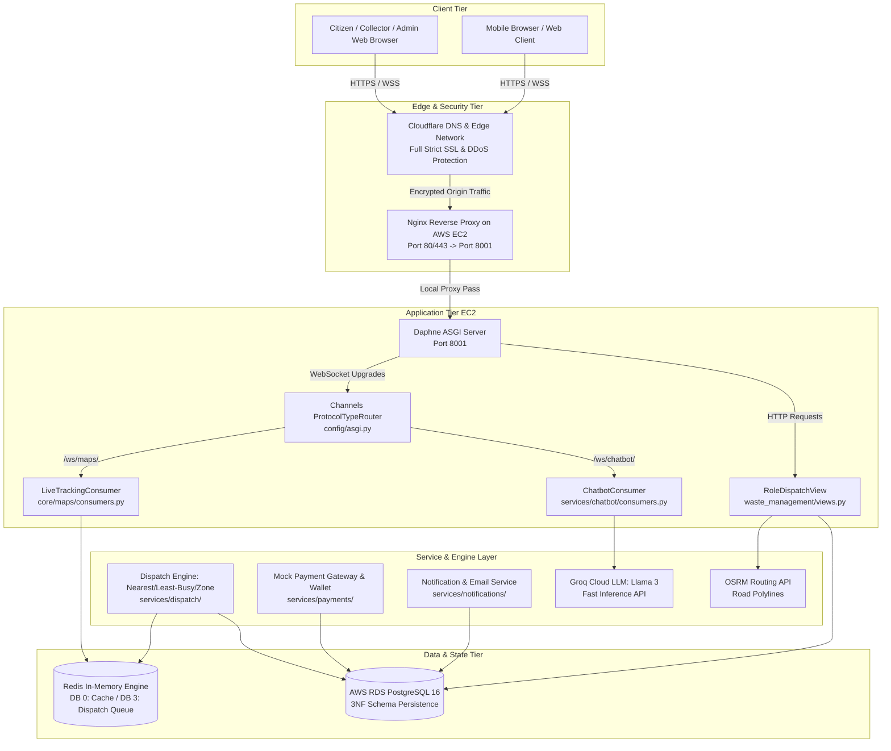
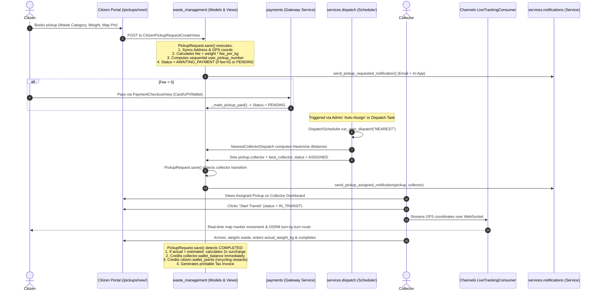

# TrashPort — MCA Project Defense (Second Review) Comprehensive Guide

**Project Name:** TrashPort — On-Demand Smart Waste Collection & Recycling Platform  
**Repository:** [github.com/albertcyriac04-lgtm/TrashPort](https://github.com/albertcyriac04-lgtm/TrashPort)  
**Live Production URL:** [https://trashport.shop](https://trashport.shop)  
**Author / Presenter:** Albert Cyriac (`albertcyriac04-lgtm` / `albert`)  
**Target Evaluation:** Second Review / Viva Project Defense  

---

## Table of Contents
1. [Evaluation Area 1: Technical Knowledge](#1-evaluation-area-1-technical-knowledge)
   - [1.1 Comprehensive Technology & Tooling Inventory](#11-comprehensive-technology--tooling-inventory)
   - [1.2 Project Architecture & Out-Loud Defense Narrative](#12-project-architecture--out-loud-defense-narrative)
   - [1.3 Core Request Lifecycle: End-to-End Pickup Flow](#13-core-request-lifecycle-end-to-end-pickup-flow)
   - [1.4 Difficult Codebase Concepts (Viva Defense Alerts)](#14-difficult-codebase-concepts-viva-defense-alerts)
2. [Evaluation Area 2: Code & Feature Implementation](#2-evaluation-area-2-code--feature-implementation)
   - [2.1 Detailed Django App Breakdown](#21-detailed-django-app-breakdown)
   - [2.2 Validation & Error-Handling Patterns](#22-validation--error-handling-patterns)
   - [2.3 Code Snippets for Live Walkthrough](#23-code-snippets-for-live-walkthrough)
3. [Evaluation Area 3: Project Scope & Business Logic](#3-evaluation-area-3-project-scope--business-logic)
   - [3.1 Business Problem & Multi-Role Scope](#31-business-problem--multi-role-scope)
   - [3.2 The Three Dispatch Algorithms Explained](#32-the-three-dispatch-algorithms-explained)
   - [3.3 Payment Gateway Simulation Notice](#33-payment-gateway-simulation-notice)
4. [Evaluation Area 4: Tools & Technologies Comparison](#4-evaluation-area-4-tools--technologies-comparison)
5. [Evaluation Area 5: Version Control & Git History](#5-evaluation-area-5-version-control--git-history)
   - [5.1 Repository Statistics & Author Distribution](#51-repository-statistics--author-distribution)
   - [5.2 Branching Model & Commit Conventions](#52-branching-model--commit-conventions)
6. [Evaluation Area 6: Deployment & Cloud Infrastructure](#6-evaluation-area-6-deployment--cloud-infrastructure)
   - [6.1 AWS + Cloudflare Production Architecture](#61-aws--cloudflare-production-architecture)
   - [6.2 Production Status: Live vs. Pending](#62-production-status-live-vs-pending)
   - [6.3 High-Frequency Viva Questions on Deployment & Infrastructure](#63-high-frequency-viva-questions-on-deployment--infrastructure)
7. [Rough Record Checklist](#7-rough-record-checklist)
8. [Individual Contribution (Albert Cyriac)](#8-individual-contribution-albert-cyriac)

---

## 1. Evaluation Area 1: Technical Knowledge

### 1.1 Comprehensive Technology & Tooling Inventory
Every tool, library, and framework listed below has been verified directly against `pyproject.toml` and `uv.lock`.

| Framework / Tool / Library | Verified Version | Purpose in TrashPort | Rationale for Selection |
| :--- | :--- | :--- | :--- |
| **Python** | `3.13` | Core execution runtime | Selected for modern language performance, optimized exception tracebacks, and typing enhancements. |
| **Django** | `6.0.7` | Core web framework | Batteries-included monolithic framework with built-in ORM, secure sessions, CSRF protection, and admin UI. |
| **Django REST Framework (DRF)** | `3.17.1` | REST API layer | Model serialization, automated CRUD ViewSets, and standardized JSON endpoints for web/mobile integration. |
| **Django Channels** | `4.3.2` | WebSocket / ASGI layer | Enables asynchronous, bi-directional communication for live GPS tracking and AI chatbot streaming. |
| **Daphne** | `4.2.3` | ASGI Application Server | Official twisted-based ASGI server for Django Channels capable of routing simultaneous HTTP and WebSocket traffic. |
| **Redis** & **channels-redis** | `8.0.1` / `4.3.0` | In-memory cache & channel layer | High-speed message broker for WebSocket channel layer, dispatch queueing, and per-user rate limiting. |
| **Celery** | `5.4.0` | Background task queue | Offloads long-running tasks (email notifications, asynchronous status updates) to prevent blocking HTTP workers. |
| **Psycopg 3** (`psycopg[binary]`) | `3.2.0` | PostgreSQL adapter | Modern binary driver supporting connection pooling, prepared statements, and async execution. |
| **PostgreSQL (AWS RDS)** | `16-alpine` | Relational 3NF database | ACID compliance, JSONB support for dynamic schemas, and robust geospatial indexing. |
| **Firebase Admin SDK** | `6.6.0` | JWT authentication | Cryptographic verification of Firebase ID tokens for mobile/web social authentication. |
| **Google Auth OAuthlib** | `1.4.0` | Server-side OAuth 2.0 PKCE | Handles backend OAuth exchange to prevent client-side `origin_mismatch` errors across custom domains. |
| **Groq SDK** | `1.7.0` | AI LLM Inference | Ultra-low latency inference (<300ms) with Llama 3 models for real-time natural language action parsing. |
| **WhiteNoise** | `6.12.0` | Static asset serving | Serves compressed, cache-hashed static assets directly from ASGI/WSGI without dedicated S3 bucket overhead. |
| **Leaflet.js + OpenStreetMap** | Modern CDN | Frontend map engine | Free, open-source geospatial mapping and marker rendering without proprietary Google Maps billing. |
| **OSRM (Open Source Routing Machine)** | Public API | Turn-by-turn road routing | Calculates true road distances and navigation paths rather than straight-line geometric distances. |
| **Argon2-cffi** | `25.1.0` | Secure password hashing | Memory-hard password hashing algorithm providing maximum resistance to GPU-assisted brute-force attacks. |
| **drf-spectacular** | `0.30.0` | OpenAPI 3.0 documentation | Auto-generates Swagger UI (`/api/docs/`) directly from viewset class definitions. |
| **uv (Astral)** | Latest | Build tool & package manager | Extremely fast Rust-based dependency resolver ensuring deterministic lockfiles (`uv.lock`). |

---

### 1.2 Project Architecture & Out-Loud Defense Narrative



#### How to Explain this Architecture Out Loud in Viva:
> *"TrashPort is designed as an asynchronous, modular web platform using Django 6 and ASGI. 
> 
> Incoming client traffic reaches our domain `trashport.shop` through **Cloudflare**, which handles DDoS protection, edge caching, and Full (Strict) SSL termination. Cloudflare forwards the encrypted traffic to an **Nginx reverse proxy** running on an **AWS EC2** instance. Nginx proxies requests to our containerized **Daphne ASGI server** running on port `8001`.
> 
> Daphne handles both standard HTTP requests and WebSocket handshakes simultaneously through our `ProtocolTypeRouter`:
> - HTTP requests are handled by our role-based view dispatcher, which directs traffic to the appropriate citizen, collector, or admin controllers.
> - WebSocket connections are routed directly to asynchronous consumers (`ChatbotConsumer` for real-time AI assistance and `LiveTrackingConsumer` for live collector vehicle GPS streaming).
> 
> Our persistence tier is fully decoupled: permanent relational data is stored in **AWS RDS PostgreSQL** modeled in strict Third Normal Form (3NF). Ephemeral data, such as real-time collector GPS coordinates, dispatch queue states, and WebSocket channel layers, are managed via **Redis**."*

---

### 1.3 Core Request Lifecycle: End-to-End Pickup Flow



---

### 1.4 Difficult Codebase Concepts (Viva Defense Alerts)

Be ready to explain these specific implementations if queried:

1. **The Dynamic Role Dispatcher (`waste_management/views.py`)**:
   * *The Problem*: Avoid exposing duplicate, messy URL paths like `/citizen/dashboard/`, `/collector/dashboard/`, and `/admin/dashboard/`.
   * *The Mechanism*: All roles navigate to `/dashboard/`. [RoleDispatchView](file:///d:/TrashPort/trashport/core/waste_management/views.py#L166) intercepts `request.user.role`, looks up the target view in a `role_map` dictionary, dynamically imports it using `importlib.import_module()`, and calls `.as_view()`.
   * *Defense Argument*: This centralizes access control, keeps frontend template links universal (``), and preserves strict separation of concerns in individual view files.

2. **3NF Normalization with Transparent Property Proxies (`users/models.py`)**:
   * *The Problem*: Storing role-specific fields (e.g. `wallet_points` for Citizens vs. `wallet_balance`, `vehicle_number`, `license_number` for Collectors) in the central `User` table creates sparse columns with lots of `NULL` values, violating Third Normal Form (3NF).
   * *The Mechanism*: Role attributes are stored in separate 1-to-1 tables ([CitizenProfile](file:///d:/TrashPort/trashport/users/models.py#L298) and [CollectorProfile](file:///d:/TrashPort/trashport/users/models.py#L323)). Transparent `@property` getters and setters on `User` automatically forward read/write calls to the underlying profile.
   * *Defense Argument*: Views can interact directly with `user.wallet_points` or `user.wallet_balance` without needing verbose queries, while the underlying SQL schema remains in strict 3NF.

3. **Server-Side Google OAuth 2.0 PKCE Flow (`users/views_google_oauth.py`)**:
   * *The Problem*: Client-side OAuth popups frequently fail in multi-environment setups (development vs. production domains) with `origin_mismatch` errors.
   * *The Mechanism*: The OAuth handshake runs entirely on the backend using `google_auth_oauthlib.flow.Flow`. It generates a cryptographic CSRF `state` and a PKCE `code_verifier` stored in `request.session`. On callback, it exchanges the authorization code directly with Google's token endpoint and queries the Google UserInfo API.

4. **Simulated Aadhaar Verification with Verhoeff Checksum (`collectors/aadhaar_service.py`)**:
   * *The Problem*: Private academic projects cannot access production UIDAI servers without an institutional AUA/KUA license under the Aadhaar Act 2016.
   * *The Mechanism*: The service implements the real mathematical **Verhoeff checksum algorithm** to validate 12-digit number structures, generates 6-digit OTPs with 5-minute expirations, and stores only a SHA-256 hash (`aadhaar_hash`) and masked display (`XXXX-XXXX-1234`). Raw Aadhaar numbers are never persisted.

---

## 2. Evaluation Area 2: Code & Feature Implementation

### 2.1 Detailed Django App Breakdown

```
TrashPort Codebase Layout:
├── config/                     (Settings, root URLs, ASGI/WSGI, DRF router)
├── trashport/
│   ├── users/                  (Authentication, 3NF profiles, Google OAuth PKCE)
│   ├── core/
│   │   ├── waste_management/   (PickupRequest, Address, Category, Payouts, RoleDispatch)
│   │   ├── maps/               (ServiceZone, CollectorLocation, OSRM routes, WebSocket GPS)
│   │   └── utils/              (Shared Redis client factory for DB 3)
│   ├── citizens/               (Citizen portal: booking, address CRUD, coupons, feedback)
│   ├── collectors/             (Collector portal: claiming, on-site weighing, Aadhaar KYC)
│   ├── admins/                 (Admin portal: live fleet map, KPIs, auto-dispatch, CSV exports)
│   └── services/
│       ├── chatbot/            (Groq LLM Llama 3, intent parsing, action handler, WebSockets)
│       ├── dispatch/           (Automated dispatch scheduler, Redis queue, algorithms)
│       ├── payments/           (Mock payment gateway, audit transactions, wallet service)
│       ├── notifications/      (Notification model, in-app alert APIs, email delivery)
│       └── firebase/           (Firebase Admin SDK, JWT validation backend)
```

#### Core Components per App:
1. **`trashport.users`**:
   * *Models*: `User` (email as `USERNAME_FIELD`), `CitizenProfile` (wallet points), `CollectorProfile` (wallet balance, vehicle number).
   * *Views*: `UserDetailView`, `UserUpdateView`, `UserDeleteView`, `firebase_session_login`, `google_oauth_start`, `google_oauth_callback`.
2. **`trashport.core.waste_management`**:
   * *Models*: `PickupRequest` (complete collection lifecycle state machine), `Address` (soft-deletable GPS location), `WasteCategory` (collection fees and recycling rates), `CollectorPayoutSetting` (earnings formula parameters), `Complaint`, `AnonymousFeedback`.
   * *Views*: `RoleDispatchView`, `DashboardView`, `PickupRequestDetailView`, `PickupStatusUpdateView`.
   * *Serializers*: `PickupRequestSerializer`, `AddressSerializer`, `WasteCategorySerializer`, `ComplaintSerializer`.
3. **`trashport.citizens`**:
   * *Views*: `CitizenDashboardView`, `CitizenPickupRequestCreateView`, `CitizenPaymentCheckoutView`, `CitizenInvoiceView`, `CitizenWalletView`, `CitizenRedeemCouponView`, `SubmitAnonymousFeedbackView`.
4. **`trashport.collectors`**:
   * *Models*: `CollectorAadhaarProfile` (verification status, hashed identity).
   * *Views*: `CollectorDashboardView`, `CollectorPickupStatusUpdateView` (actions: claim, start transit, complete, release), `AadhaarInitiateView`, `AadhaarVerifyView`, `CollectorRedeemUPIView`.
5. **`trashport.admins`**:
   * *Views*: `AdminLiveMapView`, `AdminDashboardView` (KPI aggregation, Chart.js metrics), `AdminUserListView`, `AdminAutoAssignPickupsView`, `AdminOperationsReportView`, `ExportPickupsCSVView`, `ExportRevenueCSVView`.
6. **`trashport.core.maps`**:
   * *Models*: `CollectorLocation` (live coordinates, speed, heading), `ServiceZone`.
   * *Services & Consumers*: `GeoService` (Haversine calculations, OSRM turn-by-turn routing), `LiveTrackingConsumer` (WebSocket coordinates streaming).
7. **`trashport.services.payments`**:
   * *Models*: `PaymentTransaction` (immutable audit ledger), `WalletHistory`, `UPIPayoutRequest`.
   * *Services*: `PaymentGatewayService` (mock card/UPI/wallet processing), `WalletService` (points-to-INR conversions).
8. **`trashport.services.notifications`**:
   * *Models*: `Notification` (in-app alerts with categories: `PICKUP`, `PAYMENT`, `COMPLAINT`, `SYSTEM`).
   * *Services*: `NotificationService` (in-app creation, multi-part transactional HTML email delivery).
9. **`trashport.services.dispatch`**:
   * *Models*: `DispatchBatch` (execution history and assigned counts).
   * *Stores & Schedulers*: `DispatchRedisStore` (Redis DB 3 sorted sets and ephemeral positions), `DispatchScheduler`, algorithms (`NearestCollectorDispatch`, `LeastBusyCollectorDispatch`, `ZoneBasedDispatch`).
10. **`trashport.services.chatbot`**:
    * *Models*: `ChatSession`, `ChatMessage`, `FAQ`, `ChatFeedback`, `ChatLog`.
    * *Consumers & Services*: `ChatbotConsumer` (WebSocket authentication and rate limiting), `groq_service.py` (Llama 3 API communication), `action_handler.py` (direct database actions from chat).

---

### 2.2 Validation & Error-Handling Patterns

#### Implemented Strengths:
*   **Database-Level Protection**: `WasteCategory` uses `on_delete=models.PROTECT` to prevent accidental deletion of waste categories that have active or historical pickups.
*   **Booking Date Validation**: `schedule_date` is validated in serializers and forms to enforce that bookings must be scheduled at least 3 hours in the future and cannot be set in the past.
*   **Address Uniqueness Enforcement**: Setting one address to `is_default=True` automatically resets `is_default=False` on all other addresses for that user in `Address.save()`.
*   **Atomic Database Transactions**: All financial settlements and status transitions are wrapped inside `@db_transaction.atomic` blocks to prevent partial database writes.
*   **Silent Email Degradation**: `NotificationService` uses `fail_silently=True` for SMTP email delivery so external mail server timeouts never crash user booking flows.

#### Real Gaps (Acknowledge Honestly in Viva):
*   **Concurrency Race Conditions**: If multiple collectors tap "Claim" on the exact same millisecond, standard ORM queries without explicit `select_for_update()` could theoretically cause race conditions.
*   **Chatbot Non-JSON Fallback**: If the Groq LLM outputs free-form conversational text instead of structured JSON tool calls, the parser falls back to displaying the raw message rather than automatically retrying with structured JSON mode.
*   **Synchronous Dispatch Triggering**: Celery task stubs exist in `tasks.py`, but automated batch dispatch is currently triggered synchronously from the Admin UI rather than running on a continuous background Celery beat daemon.

---

### 2.3 Code Snippets for Live Walkthrough

#### Snippet 1: Nearest-Collector Dispatch Algorithm ([services/dispatch/algorithms/nearest.py](file:///d:/TrashPort/trashport/services/dispatch/algorithms/nearest.py))
```python
class NearestCollectorDispatch:
    """Assigns pending pickup requests to the geographically nearest available collector."""
    @staticmethod
    def assign_pickups(pickups: list, collectors: list) -> Tuple[list, list]:
        assigned = []
        unassigned = []
        if not collectors:
            return assigned, list(pickups)

        for pickup in pickups:
            p_lat = getattr(pickup.address, "latitude", None)
            p_lon = getattr(pickup.address, "longitude", None)

            if p_lat is None or p_lon is None:
                best_collector = collectors[0]
            else:
                best_collector = min(
                    collectors,
                    key=lambda c: (
                        GeoService.haversine_distance(
                            float(getattr(c.live_location, "latitude", p_lat)),
                            float(getattr(c.live_location, "longitude", p_lon)),
                            float(p_lat),
                            float(p_lon)
                        ) if hasattr(c, "live_location") else 9999.0
                    )
                )

            pickup.collector = best_collector
            pickup.status = "ASSIGNED"
            pickup.save()
            assigned.append((pickup, best_collector))

        return assigned, unassigned
```
*Walkthrough points: Iterates over pending pickups, computes Haversine distance to each collector's live location, assigns the closest collector using Python's `min()`, and saves the updated state.*

#### Snippet 2: Chatbot WebSocket Connection & Auth ([services/chatbot/consumers.py](file:///d:/TrashPort/trashport/services/chatbot/consumers.py#L50-L85))
```python
    async def connect(self):
        query_string = self.scope.get("query_string", b"").decode("utf-8")
        params = parse_qs(query_string)
        token_list = params.get("token", [])
        token = token_list[0] if token_list else None

        if not token:
            await self.close(code=4001)
            return

        try:
            decoded_token = verify_firebase_id_token(token)
            uid = decoded_token.get("uid")
            if not uid:
                raise FirebaseAuthenticationError("Decoded token missing uid.")

            user = await sync_to_async(_get_user_by_uid)(uid)
            if not user:
                await self.close(code=4001)
                return

            self.user = user
            await self.accept()
            await self.send(json.dumps({
                "type": "greeting",
                "message": f"Hi {user.name or user.email}! How can I help you today?"
            }))
        except Exception as e:
            await self.close(code=4001)
```
*Walkthrough points: Authenticates browser WebSockets via query-string token, cryptographically verifies Firebase ID tokens, links the connection to `self.user`, and sends an initial greeting.*

#### Snippet 3: Role-Based View Dispatcher ([waste_management/views.py](file:///d:/TrashPort/trashport/core/waste_management/views.py#L191-L227))
```python
    def dispatch(self, request, *args, **kwargs):
        if not request.user.is_authenticated:
            return self.handle_no_permission()

        role = getattr(request.user, "role", None)
        if request.user.is_superuser:
            role = User.Roles.ADMIN

        view_path = self.role_map.get(role)
        if not view_path:
            return HttpResponseForbidden("Invalid role")

        module_path, class_name = view_path.rsplit(".", 1)
        module = importlib.import_module(module_path)
        view_class = getattr(module, class_name)

        return view_class.as_view()(request, *args, **kwargs)
```
*Walkthrough points: Inspects user role, dynamically loads the corresponding view class from `role_map` using runtime reflection, and delegates request handling.*

#### Snippet 4: Pickup Completion & Compensation Logic ([waste_management/models.py](file:///d:/TrashPort/trashport/core/waste_management/models.py#L627-L674))
```python
        else:
            # UPDATE path: extra weight penalty calculation
            if self.actual_weight_kg is not None and self.actual_weight_kg > self.weight_kg:
                extra_weight = Decimal(str(self.actual_weight_kg)) - Decimal(str(self.weight_kg))
                # 2x rate applied to excess weight as penalty surcharge
                self.extra_fee = extra_weight * Decimal(str(self.category.fee_per_kg)) * Decimal("2.00")
                base_fee = Decimal(str(self.weight_kg)) * Decimal(str(self.category.fee_per_kg))
                self.fee = base_fee + self.extra_fee

            # Recalculate collector earnings with final extra_fee
            self.collector_earnings = self.calculate_collector_earnings()
            orig = PickupRequest.objects.get(pk=self.pk)

            # Trigger: Status changed to COMPLETED
            if orig.status != self.StatusChoices.COMPLETED and self.status == self.StatusChoices.COMPLETED:
                if self.points_earned > 0:
                    WalletService.adjust_points(
                        user=self.citizen,
                        points_delta=self.points_earned,
                        reason=f"Recycling reward: {self.weight_kg}kg {self.category.name} (Pickup #{self.display_id})"
                    )
                if self.collector:
                    self.collector.wallet_balance += self.collector_earnings
                    self.collector.save()
```
*Walkthrough points: Calculates a 2x penalty surcharge for excess weight, updates total collector earnings, credits recycling points to the citizen, and transfers cash earnings to the collector's wallet.*

---

## 3. Evaluation Area 3: Project Scope & Business Logic

### 3.1 Business Problem & Multi-Role Scope
Urban and suburban waste management faces three structural problems:
1. **Inefficient Static Routing**: Garbage trucks operate on rigid routes regardless of actual waste volume, wasting fuel and labor.
2. **Zero Citizen Recycling Incentives**: Citizens have no tangible incentive to separate recyclable materials (metals, e-waste, plastics) from municipal solid waste.
3. **Informal Sector Disconnect**: Field waste collectors have unpredictable income, lack route visibility, and have no direct digital link with households.

**TrashPort's Solution via Role-Based Workflows:**
*   **Citizen**: Schedules on-demand collections with interactive map pins; pays per pickup; earns recycling reward points (100 points = ₹10 off future bookings); files complaints; tracks collectors in real time.
*   **Collector**: Completes simulated Aadhaar onboarding; views available pickups prioritized by proximity and estimated earnings; claims pickups; uses turn-by-turn road navigation; verifies actual waste weight on-site; accumulates cash earnings and withdraws to UPI.
*   **Admin**: Monitors city-wide collection operations on a live map; runs automated batch dispatch algorithms; resolves citizen grievances; configures per-kg collection pricing and collector compensation formulas; downloads CSV audit reports.

---

### 3.2 The Three Dispatch Algorithms Explained

The dispatch engine ([trashport/services/dispatch/](file:///d:/TrashPort/trashport/services/dispatch/)) provides three pluggable strategies:

| Algorithm | Class Name & File | How It Works | When to Use / Scenario |
| :--- | :--- | :--- | :--- |
| **Nearest Collector** | `NearestCollectorDispatch` | Calculates the spherical Haversine distance between the pickup location and the live GPS coordinate of all active collectors. Assigns each pickup to the closest collector. | **Default Mode**: Used for rapid, ad-hoc, urgent collections where minimizing travel distance and citizen wait time is the top priority. |
| **Least Busy Collector** | `LeastBusyCollectorDispatch` | Evaluates the active workload (`ASSIGNED` + `IN_TRANSIT` count) of all active collectors. Assigns pickups to the collector with the lowest task count. | **Load Balancing**: Used during peak operational hours to prevent individual collectors from becoming overwhelmed with multi-stop tasks. |
| **Zone-Based Dispatch** | `ZoneBasedDispatch` | Matches the pickup's city or postal code against the collector's assigned `ServiceZone`. Falls back to least-busy if no collector is present in that zone. | **Municipal Zoning**: Used in large municipal areas where waste management agencies are partitioned into strict administrative wards. |

---

### 3.3 Payment Gateway Simulation Notice
> [!IMPORTANT]
> **VIVA NOTE ON PAYMENTS:**
> The payment gateway in TrashPort ([trashport/services/payments/services.py](file:///d:/TrashPort/trashport/services/payments/services.py)) is an **intentional, fully featured dummy/mock gateway**.
> - Do **not** claim to have integrated a live commercial payment gateway (e.g. Razorpay, Stripe) with real banking rails.
> - Explain that it simulates a full payment gateway lifecycle: it has a catalog of test card numbers mapped to specific response codes (`card_declined`, `insufficient_funds`, `expired_card`), supports mock UPI VPA verification, creates immutable `PaymentTransaction` audit records in the database, generates tax invoices, and supports full wallet-point settlement.
> - *Reason*: Real merchant gateways require registered business entities, recurring merchant fees, and commercial KYC, which are outside the scope of an academic prototype.

---

## 4. Evaluation Area 4: Tools & Technologies Comparison

| Technology | Role in TrashPort | Why Chosen Over Alternatives? |
| :--- | :--- | :--- |
| **Nginx on EC2** | Reverse proxy & web server | Chosen over AWS Application Load Balancer (ALB) because an ALB costs ~$18–$25/month minimum. Nginx on our EC2 instance handles reverse proxying, static caching, and WebSocket connection upgrades on a single t3.small instance at zero extra cost. |
| **Cloudflare** | DNS, CDN & Full Strict SSL | Provides free global SSL certificates, DDoS mitigation, and edge caching without needing AWS Certificate Manager (which requires an ALB) or manual certbot renew cron jobs. |
| **PostgreSQL (AWS RDS)** | Relational database (3NF) | Chosen over SQLite (not production-safe for concurrency) and MongoDB (relational 3NF integrity is mandatory for financial transactions, wallet history, and foreign-key cascades). |
| **Redis** | Broker, cache & ephemeral queue | Chosen over Memcached because Memcached lacks data structures; Redis sorted sets (`ZADD`/`ZPOPMIN`) are essential for our dispatch queue and Django Channels WebSocket layer. |
| **uv (Astral)** | Package manager & build tool | Chosen over traditional `pip` + `virtualenv` because `uv` is written in Rust, resolves dependencies 10–100x faster, and ensures deterministic lockfiles (`uv.lock`). |
| **Groq API** | LLM inference provider | Chosen over OpenAI GPT-4 API because Groq’s LPU (Language Processing Unit) architecture delivers responses in under 300ms, essential for real-time WebSocket chat streaming. |
| **Leaflet.js + OSM** | Map engine | Chosen over Google Maps JavaScript API because Google Maps requires credit card billing and charges per tile/API hit. Leaflet + OpenStreetMap is free, lightweight, and open-source. |
| **OSRM** | Road routing engine | Chosen over Google Directions API for turn-by-turn polyline generation because it provides open road-network calculation without API quotas or billing keys. |

---

## 5. Evaluation Area 5: Version Control & Git History

### 5.1 Repository Statistics & Author Distribution
*   **Total Commits on `main`**: 120+ commits
*   **Commit Authors & Contribution Breakdown**:
    1. **Albert Cyriac (`albertcyriac04-lgtm` / `albert`)**: **63 commits** (Lead Architect, backend core, Docker, deployment, 3NF refactoring, Groq chatbot, maps)
    2. **Tojo Tom (`Tojo-Tom`)**: 15 commits (Collector UI, Aadhaar verification views, Docker configs)
    3. **Anjana Unnikrishnan (`anjanaunnikrish`)**: 5 commits (Citizen wallet views, coupon redemption, dependency conflicts)
    4. **Noble Sunil (`Noble`)**: 4 commits (Codebase refactoring, documentation, dead file cleanup)
    5. **Alan (`Alan`)**: 2 commits (Notification & user documentation)
    6. **Dependabot**: 23 automated dependency updates

### 5.2 Branching Model & Commit Conventions
*   **Branching Strategy**: Feature-Branch Workflow with contributor-named branches (`albert`, `tojo`, `anjana`, `noble`, `alan`), merging into staging integration branches (`test`, `test1`, `testbeformainbranch`) before final pull requests into `main`.
*   **Commit Message Convention**: Followed **Conventional Commits** (`feat:`, `fix:`, `refactor:`, `docs:`, `perf:`, `chore:`) to ensure transparent audit logs.
*   **Key Historic Milestones**:
    *   `38ecff6` & `9e49aef`: Complete 3NF database normalization and consolidation into 6 modular domain directories.
    *   `b90bcce`: Transitioned business model from subscriptions to on-demand pay-per-collection pricing.
    *   `e8d16cc` & `395cb69`: Production Docker configuration, binding port 80 and configuring `trashport.shop` domains.

---

## 6. Evaluation Area 6: Deployment & Cloud Infrastructure

### 6.1 AWS + Cloudflare Production Architecture
*   **Host**: AWS EC2 Instance (Ubuntu 22.04 LTS).
*   **Containerization**: Multi-stage `Dockerfile` leveraging `uv:python3.13-bookworm-slim` for compiling dependencies and minimal `python:3.13-slim-bookworm` for runtime.
*   **Database**: Managed **AWS RDS PostgreSQL** instance (`trashport.c...rds.amazonaws.com`), connected securely via `DATABASE_URL` in `.env`.
*   **Reverse Proxy & SSL**: Nginx listening on port 80/443, proxying to Daphne on port 8001. Cloudflare provides DNS, edge CDN caching, and **Full (Strict) SSL** for `trashport.shop`.
*   **CI/CD Pipeline**:
    *   `.github/workflows/ci.yml` runs automated Pytest tests, Django check migrations, and linting on every push to `main` and `albert`.
    *   Deployment to EC2 is performed either via GitHub Actions (`appleboy/ssh-action`) pulling latest `main` and triggering `docker compose up -d --build`, or manual SSH administration.

### 6.2 Production Status: Live vs. Pending
*   ✅ **Live in Production**: Domain DNS routing (`trashport.shop`), Cloudflare SSL, Docker container build, RDS PostgreSQL database connectivity, User registration & Google OAuth 2.0 PKCE flow, Citizen & Collector dashboards, Simulated Aadhaar KYC, Leaflet Map integration, Mock payment checkout & invoice generation.
*   ⚠️ **Pending / In-Progress**:
    *   Production Celery Beat background daemon (currently running tasks synchronously).
    *   Cloudflare WebSocket timeout tuning (Cloudflare free tier closes idle WebSockets after 100 seconds; needs periodic client ping/pong heartbeat).

### 6.3 High-Frequency Viva Questions on Deployment & Infrastructure

**Q1: Why did you put Daphne behind Nginx instead of exposing Daphne directly on port 80?**  
> *"Daphne is an application server optimized for Python ASGI execution, not high-volume edge request buffering or static file delivery. Nginx acts as a reverse proxy that buffers slow clients, handles SSL termination, manages connection timeouts, handles Gzip compression, and proxies WebSocket upgrade headers (`Upgrade $http_upgrade`, `Connection 'upgrade'`) reliably to Daphne."*

**Q2: How does Cloudflare Full (Strict) SSL work with your EC2 instance?**  
> *"In Cloudflare Full (Strict) mode, Cloudflare encrypts traffic between the end-user's browser and Cloudflare's edge servers. Cloudflare then establishes a separate, authenticated SSL connection between Cloudflare's edge and our origin Nginx server on EC2 using an Origin CA certificate. This ensures end-to-end encryption without exposing plain HTTP anywhere on public networks."*

**Q3: How do you handle environment secrets in production?**  
> *"Secrets such as `DJANGO_SECRET_KEY`, `DATABASE_URL` (AWS RDS credentials), `GROQ_API_KEY`, and Google OAuth client secrets are never committed to git. They are injected at runtime via an untracked `.env` file on the EC2 server and passed into Docker containers via the `env_file` directive in `docker-compose.yml`."*

**Q4: How do database migrations run during deployment?**  
> *"In our `Dockerfile` and `docker-compose.yml`, the container startup command is chained: `sh -c "python manage.py migrate && python manage.py runserver 0.0.0.0:8001"`. Whenever a new container starts, Django executes `migrate` first. If any migration fails, the container halts, preventing an out-of-sync application from serving traffic."*

---

## 7. Rough Record Checklist

Cross-referencing university MCA project guidelines against current repository artifacts:

| Guideline Requirement | Current Status in Repo | Action Item for Student |
| :--- | :---: | :--- |
| **Objectives & Scope** | ✅ Complete | Documented in `pages/about.html` and Section 3 of this document. |
| **System Architecture Diagram** | ⚠️ Needs Export | Diagram is provided in Section 1.2 in Mermaid format. **Action**: Render and print as image/PDF for your physical record book. |
| **Entity Relationship (ER) Diagram** | ⚠️ Missing in Repo | Models are complete in code. **Action**: Run `python manage.py graph_models -a -o er_diagram.png` or draw the ER diagram showing `User`, `CitizenProfile`, `CollectorProfile`, `PickupRequest`, `Address`, `WasteCategory`, `Complaint`, `PaymentTransaction`. |
| **Data Flow Diagrams (DFD Level 0 & 1)** | ⚠️ Missing in Repo | **Action**: Draw DFD Level 0 (Context Level) and Level 1 showing Citizen, Collector, and Admin processes. |
| **UI Screenshots** | ⚠️ Pending Print | **Action**: Take screenshots of: (1) Landing page, (2) Citizen pickup booking with Leaflet map pin, (3) Payment checkout page, (4) Collector dashboard & Aadhaar verification, (5) Admin live map with KPIs. |
| **Issues Faced & Resolved** | ✅ Documented | 1. Google OAuth popup `origin_mismatch` resolved via server-side PKCE flow.<br/>2. 3NF database normalization decoupled citizen points from collector cash.<br/>3. OSRM API failures handled via local curved waypoint generator fallback. |
| **Git & Deployment Evidence** | ✅ Verified | GitHub repo active, 120+ commits, commit log summary ready, live domain `trashport.shop`. |

---

## 8. Individual Contribution (Albert Cyriac)

*Use this section to speak with total confidence about what you personally engineered.*

As the **Lead Architect and Primary Backend/DevOps Engineer** on the project, my direct personal contributions span over **63 commits** across every layer of the system:

1. **System Refactoring & 3NF Normalization (`commit 38ecff6`, `9e49aef`)**:
   * Refactored the legacy monolithic database schema into a normalized Third Normal Form (3NF) architecture, separating `User` credentials from `CitizenProfile` and `CollectorProfile`.
   * Reorganized the entire codebase into a clean, scalable multi-app directory structure: `core/`, `services/`, `admins/`, `citizens/`, `collectors/`, and `users/`.

2. **Core Domain & Dispatcher Pattern (`commit 214f929`, `77a0875`)**:
   * Engineered the `RoleDispatchView` in `trashport/core/waste_management/views.py`, enabling unified URLs that dynamically route to role-specific logic at runtime.
   * Implemented the entire `PickupRequest` lifecycle state machine, automated excess weight penalty calculations ($2\times$ rate), and collector compensation formulas.

3. **Production DevOps & AWS Infrastructure (`commit e8d16cc`, `70b056a`, `395cb69`, `c9865aa`)**:
   * Containerized the platform with a multi-stage `Dockerfile` using `uv` for minimal image size and fast caching.
   * Configured Docker Compose for production, binding port 80 and wiring AWS RDS PostgreSQL via `.env`.
   * Configured `ALLOWED_HOSTS`, `CSRF_TRUSTED_ORIGINS`, and Nginx reverse proxy routing for the live deployment on `trashport.shop`.

4. **Security & Server-Side Google OAuth 2.0 PKCE (`commit d1bd63f`, `2838501`, `e5cc1cf`)**:
   * Completely eliminated browser popup OAuth `origin_mismatch` issues by writing a server-side Google OAuth flow with PKCE verifiers in `trashport/users/views_google_oauth.py`.
   * Sanitized repository history to ensure zero API keys or credentials were leaked to GitHub.

5. **AI Chatbot & Groq LLM Integration (`commit 2791740`, `e727327`)**:
   * Implemented the WebSocket `ChatbotConsumer` with per-user rate limiting using Redis.
   * Designed the system prompt and action handler that allows the Groq LLM to check pickup statuses, reschedule dates, and book collection requests directly from chat.

6. **Maps & Low-Latency Geolocation (`commit 7cc31ec`, `fad74e0`, `709dcf7`)**:
   * Integrated Leaflet.js with OpenStreetMap and OSRM turn-by-turn road route navigation.
   * Built the real-time `LiveTrackingConsumer` WebSocket channel for live collector GPS updates, preventing memory leaks on mobile devices.
